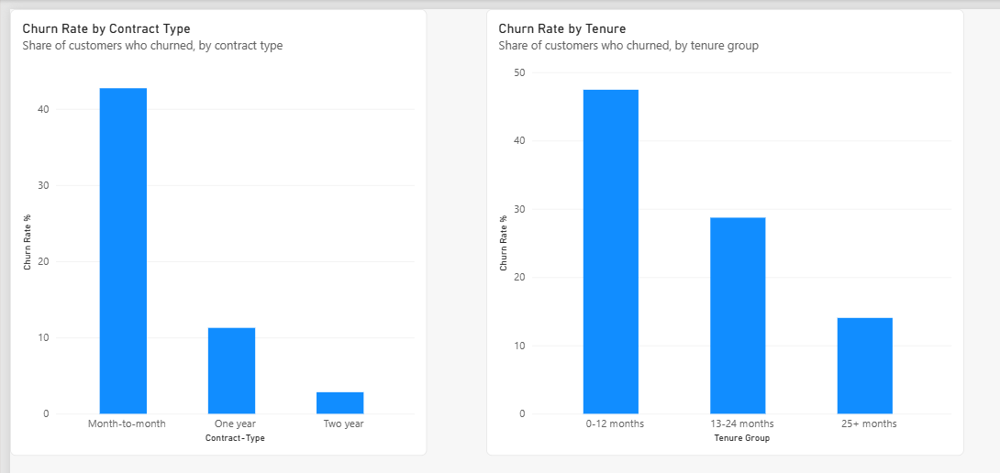

# Customer Churn Analysis (Telco Dataset)

## Business question
Which customers are leaving, and what factors are linked to churn?

## Data
Telco customer churn dataset (7,043 customers), file `telco_churn.csv`. Source: Kaggle, "Telco Customer Churn" (IBM sample data).

## Tools
- MySQL 8.0 (data cleaning and analysis, `churn_analysis.sql`)
- Power BI Desktop (dashboard, `churn_dashboard.pbix`)

## Method
1. Loaded the CSV into MySQL and checked the row count and churn split.
2. Cleaned `TotalCharges`: 11 blank values set to NULL, then converted to a decimal column.
3. Calculated churn rate by contract type, tenure group, and monthly charge band.
4. Built a two-chart Power BI dashboard.

## Key findings
- Overall churn: 26.5% (1,869 of 7,043 customers).
- Month-to-month contracts churn at 42.7%, versus 2.8% for two-year contracts.
- Customers in their first 12 months churn at 47.4%, versus 14.0% after 25 months.
- Customers paying over $70 per month churn at 35.5%, versus 10.9% under $35.

## Dashboard

## Files
- `churn_analysis.sql`: all SQL queries, in order
- `churn_dashboard.pbix`: Power BI dashboard
- `churn_dashboard_ss.png`: dashboard screenshot
- `telco_churn.csv`: source data